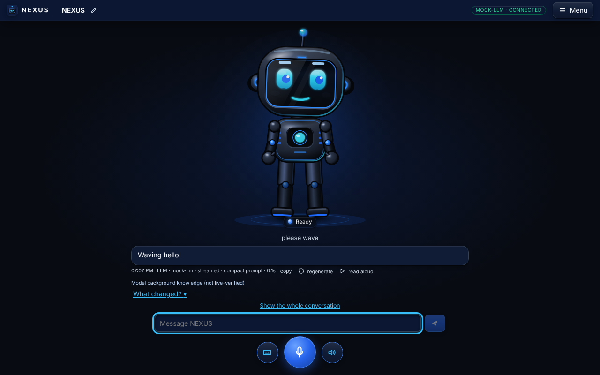

# NEXUS — an AI companion with an animated 2D robot body

<p align="center"></p>

NEXUS is a voice-first AI companion. The interface **is** an original, fully articulated 2D robot: it listens, thinks,
speaks and gestures in step with what the AI is actually doing. Conversation comes from a real language model through
a small local server that keeps every API key out of the browser.

- **Real LLM brain** — OpenAI-compatible APIs (OpenAI, OpenRouter, Groq, LM Studio…), Anthropic, or a free model on your own
  computer with Ollama (downloadable from inside the app). A clearly labelled demo brain works with no setup — it is not an AI.
- **Expressive robot** — SVG rig with separately animated head, eyes, brows, mouth, torso, arms, hands, legs and feet;
  19 expressions and 40+ motions run by one animation engine with priorities, blending and safe interruption.
- **Voice** — talk with the microphone; replies are spoken. With an optional speech service (any OpenAI-compatible audio API)
  the mouth follows the real audio level and voice input works in the desktop app too.
- **One honest lifecycle** — IDLE → LISTENING → PROCESSING → SPEAKING ⇄ PAUSED, with INTERRUPTED, ERROR and RECOVERING;
  stopping cancels the request, the speech and the gestures together.
- **Memory you control** — saved only on your computer, only when you ask or approve; view, edit, export or delete it.
- **Safe skill learning** — new gestures and expressions are proposed as data, validated and simulated, previewed in a
  sandbox and saved only after you approve them (versioned, with rollback). The language model itself is never retrained.

## Quick start

Requires [Node.js 20+](https://nodejs.org).

```bash
git clone __REPO_URL__.git
cd __REPO_NAME__
npm install
npm start            # → http://localhost:8787  (opens the home page; the robot is at /app)
```

Or run it as a desktop app: `npm run desktop`. Build a single-file Windows app with `npm run dist:win` (→ `release/NEXUS.exe`).
To use a real AI, open **Settings → Model** in the app (or copy `.env.example` to `.env`). Windows users can also
double-click `start-nexus.bat`. More: **[docs/LAPTOP.md](docs/LAPTOP.md)** and **[docs/SETUP.md](docs/SETUP.md)**.

## Development

```bash
npm run dev        # → http://localhost:5173  (API on :8787)
npm run lint       # ESLint
npm test           # unit + integration tests
npm run report     # everything (types, lint, build, tests, browser e2e, desktop smoke) → docs/RELEASE_REPORT.md
```

No credentials are needed for the demo. The demo brain is scripted and the UI labels it **"not an LLM"**.
For real conversation, configure a provider in **Settings → Model** or `.env` — see [docs/SETUP.md](docs/SETUP.md).

## What is real, what is partial, what is future

**Working (and tested):** the 2D character and all expressions/poses/motions; the animation engine (blending, priorities,
cancellation, recovery); the state machine; the conversation pipeline with streaming, cancellation, retry and typed errors
(tested against mock OpenAI-compatible and Anthropic endpoints); schema validation of everything the model returns; memory
with consent, retrieval, conflict handling, edit/delete, import/export; the skill proposal → validation → sandbox preview →
approval → versioning/rollback loop; research adapters (Wikipedia/SearXNG/Tavily, tested with mocked HTTP); voice module
logic (tested with fake browser engines); settings, quiet mode, accessibility modes, responsive layout; diagnostics; the
capability and asset registries.

**Partial / approximate:** lip movement is approximate (vowel shape at speech word boundaries, not phoneme lip-sync);
"turning" is a three-quarter 2D feature shift, not a true side view; preview isolation is a separate engine instance over
data-only skills, not a separate process; the demo brain understands only a fixed set of phrasings.

**Not verified here:** a live paid LLM, live search services, a real Ollama install and real microphone/voice output were
not reachable from the build environment — those paths are verified with mocks and fakes only. `NEXUS.exe` was
built (cross-compiled) but not run on Windows; the `.bat` scripts were not run on Windows. The desktop app itself
was started and checked on Linux. Inside the desktop app, voice input needs a configured transcription service (Electron has no built-in speech-to-text); the speech-service paths were tested only against mock OpenAI-compatible audio servers.

**Not implemented (by design):** model training or fine-tuning. NEXUS "learns" by saving approved skills, memories and
preferences in your browser. The language model never changes.

## Docs

- [docs/LAPTOP.md](docs/LAPTOP.md) — the NEXUS desktop app, free offline AI (Ollama), keyboard shortcuts
- [docs/SETUP.md](docs/SETUP.md) — install, providers, research, voice, commands
- [docs/ARCHITECTURE.md](docs/ARCHITECTURE.md) — modules and data flow
- [docs/PRIVACY.md](docs/PRIVACY.md) — what is stored where, who receives what
- [docs/CAPABILITIES.md](docs/CAPABILITIES.md) — capability matrix
- [docs/FEATURE_AUDIT.md](docs/FEATURE_AUDIT.md) — every requirement of the master prompt → status → evidence
- [docs/RELEASE_REPORT.md](docs/RELEASE_REPORT.md) — **generated** by `npm run report` from real results: build, tests, and the status of all 100 assets

## Project layout

| Path | |
|---|---|
| `shared/` | rig channels, schemas for every boundary, stream parser, demo brain |
| `server/` | Express API, providers (demo / OpenAI-compatible / Anthropic), research adapters, versioned prompts, config; `start.ts` is shared by the CLI and the desktop app |
| `desktop/` | Electron main process for the desktop app (packaging config in `package.json` → `build`) |
| `build/` | app icon (SVG source, PNG, ICO) |
| `start-nexus.*`, `setup-offline-ai.*`, `rebuild-nexus.bat` | developer scripts for running from source in a browser (not needed with `NEXUS.exe`) |
| `src/character/` | tokens, geometry, poses, consistency rules, SVG robot |
| `src/expressions/` | presets and expression controller |
| `src/animation/` | timeline, engine, built-in motions |
| `src/skills/` | validator/simulator, generators, registry, learning workflow, sandbox |
| `src/ai/` | API client (SSE), context manager, planner, capability registry |
| `src/memory/` | memory store and retrieval |
| `src/voice/` | microphone permission, recognition, text-to-speech |
| `src/core/` | companion orchestrator, state machine, notifications, runtime |
| `src/components/` | workspace UI panels, rename dialog |
| `src/site/` | landing page, about/privacy/404, shared site header & footer, standalone preview robot |
| `src/router.tsx` | tiny history-API router |
| `shared/identity.ts` | product brand vs. robot display name vs. character id; name validation |
| `src/security/`, `src/diagnostics/` | validation, tool permissions, diagnostics |
| `src/assets/registry.ts` | machine-readable registry of the 100 assets |
| `src/tests/` | unit and integration tests (each tagged with asset ids); `scripts/e2e.mjs` browser tests |
